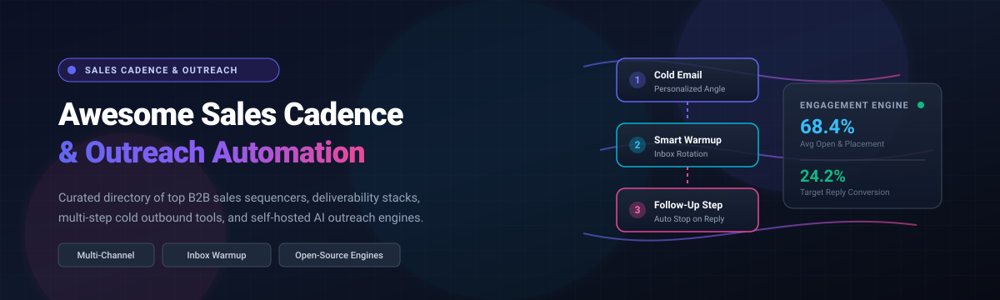

# 🚀 Awesome Sales Cadence & Outreach Automation 

  

  
  
  
  
  
  
  

---

## 📖 Overview & Ecosystem Scope

A curated directory and guide to the best **Sales Cadence & Outreach Automation** SaaS platforms, AI SDR tools, deliverability engines, and self-hosted open-source software. 

Sales cadence and engagement systems enable growth teams, SDRs, and revenue leaders to orchestrate multi-touch outbound campaigns across **cold email, LinkedIn messaging, dialers, SMS, and WhatsApp**—automating follow-ups, enforcing sender capacity limits, safeguarding email deliverability, and tracking intent signals to scale revenue pipelines predictably.

---

## 📊 Sector Overview & Market Dynamics

The global **Sales Engagement & Outreach Automation** software market size is estimated at **$9.2 Billion in 2026** (growing at a ~14.8% CAGR toward $15+ Billion by 2030). The sector is **moderately fragmented**: enterprise revenue intelligence and CRM-integrated cadences are anchored by giants like HubSpot, Outreach, and Salesloft, while a vibrant, fiercely competitive tier of agile challengers (Apollo.io, Instantly, Lemlist, Smartlead) and innovative self-hosted open-source solutions capture SMB, agency, and developer-led growth.

---

## 📑 Table of Contents

- [📊 Sector Overview & Market Dynamics](#-sector-overview--market-dynamics)
- [🏢 SaaS & Hosted Platforms](#-saas--hosted-platforms)
- [💻 Open-Source GitHub Projects](#-open-source-github-projects)
- [⚙️ Open-Source Architectural Patterns](#️-open-source-architectural-patterns)
- [🤝 How to Contribute](#-how-to-contribute)
- [💖 Support & Appreciation](#-support--appreciation)
- [⚖️ Disclaimer & Compliance](#️-disclaimer--compliance)
- [⭐ Star History](#-star-history)

---

## 🏢 SaaS & Hosted Platforms

Below is a comparison of premier commercial sales cadence, multi-channel outreach, and cold email platforms—sorted in descending order by enterprise valuation and scale.

| Platform | Company Valuation / Scale | Starting Pricing | Free Tier Limits / Free Trial | Key Capabilities & Highlights |
| :--- | :--- | :--- | :--- | :--- |
| **[HubSpot Sales Hub](https://www.hubspot.com/)** | **~$31.0 Billion** (Public: NYSE: HUBS) | **$15/user/month** (Sales Hub Starter billed annually) or $90/user/mo for Professional | **Free Forever CRM Plan**: 1:1 email tracking (up to 200 notifications/month), 5 email templates, 1 meeting link, 15 min calling; 14-day free trial for Professional/Enterprise sequences | Enterprise CRM-native cadences, task sequences, meeting scheduling, email tracking, CPQ, and AI predictive deal scoring. |
| **[Salesloft](https://salesloft.com/)** | **~$2.3 Billion** (Acquired by Vista Equity) | **~$75 - $125/user/month** (Essential/Advanced tiers, billed annually) | **14-day guided proof of concept / free sandbox trial** (available upon sales request with full feature access) | Multi-channel cadences, native sales dialer, Rhythm AI prioritization engine, conversation intelligence, and deal health insights. |
| **[Apollo.io](https://www.apollo.io/)** | **~$1.6 Billion** (Series D unicorn) | **$49/user/month** (Basic plan, billed annually) | **Free Forever Plan**: 60 mobile credits/year, 120 export credits/year, 10,000 word AI generation/month, and basic email sequences (up to 250 emails/day) | Massive database of 275M+ B2B contacts, built-in multi-step email cadences, dialer, automated enrichment, and buying intent filters. |
| **[Outreach](https://www.outreach.io/)** | **~$4.4 Billion** (Peak Series F valuation) | **~$100/user/month** (Standard plan base estimate, annual contract) | **14-day custom enterprise evaluation trial** (provided through sales consultation with representative sequence limits) | Enterprise sales engagement standard, multi-channel sequences, Kaia conversation intelligence, pipeline forecasting, and mutual action plans. |
| **[Instantly](https://instantly.ai/)** | **~$250 Million** (Estimated private valuation) | **$37/month** (Growth tier, up to 1,000 active contacts & 5,000 emails/mo) | **14-day free trial**: includes 100 active leads, 350 emails, and access to automated email account warmup | Unlimited sender email accounts, automated inbox warm-up, lead verification, high-volume sending rotation, and built-in B2B lead finder. |
| **[Lemlist](https://www.lemlist.com/)** | **~$150 Million** (Bootstrapped / ~$30M+ ARR) | **$39/seat/month** (Standard Email Pro plan, billed annually) | **14-day free trial**: 100 free enrichments, access to multi-channel sequence builder, dynamic image personalization, and lemwarm warmup | Dynamic personalized images/videos in emails, multichannel sequences (Email, LinkedIn, WhatsApp, Cold Calls), and built-in bounce verification. |
| **[Reply.io](https://reply.io/)** | **~$100 Million** (Estimated ARR scale) | **$49/user/month** (Email Volume plan, billed annually) | **14-day free trial**: full platform access with 200 data credits, sequence testing, and multichannel execution without credit card | AI-generated multichannel cadences (Email, LinkedIn, Calls, SMS, WhatsApp), cloud dialer, and Jason AI meeting booking assistant. |
| **[Woodpecker](https://woodpecker.co/)** | **~$50 Million** (Public: WSE: WPC) | **$29/month** (Cold Email starter, 500 contacted prospects/mo) | **7-day free trial**: up to 50 contacted prospects, full deliverability suite access, Condition-based follow-ups, and email warmup | Deliverability-first sender rotation, bounce shield, real human-like sending algorithms, and automated A/B sequence split testing. |
| **[Mixmax](https://www.mixmax.com/)** | **~$45 Million** (Estimated valuation) | **$29/user/month** (Growth plan, billed annually) | **Free Forever Plan**: 100 tracked emails/month, basic scheduling calendar, 10 email template shortcuts; 14-day trial of Enterprise sequence features | Native Gmail and Outlook sidebar workflow, in-email interactive polls and surveys, automated sequences, and Salesforce bidirectional sync. |
| **[Mailshake](https://mailshake.com/)** | **~$35 Million** (Estimated valuation) | **$29/user/month** (Email Outreach plan, billed annually) | **7-day free trial**: full sequence feature access with 50 test email sends, dialer sandbox, and email validation credits | Intuitive sequence builder, automated follow-up conditions, integrated VOIP phone dialer, Lead Catcher inbox, and Shakespeare AI copywriter. |

---

## 💻 Open-Source GitHub Projects

Explore the leading open-source sales outreach projects, personal sequencers, and deliverability stacks—sorted in descending order by GitHub stargazers count.

| Project | Stars | Primary Language / Stack | Architecture & Core Capabilities |
| :--- | :--- | :--- | :--- |
| **[Mautic](https://github.com/mautic/mautic)** |  | PHP / Symfony | Full-scale marketing automation & email sequencing engine; visual campaign builder, dynamic lead scoring, contact lifecycle management, and web tracking. |
| **[Harvey](https://github.com/ethanplusai/harvey)** |  | TypeScript / Python | Autonomous AI sales agent powered by Claude Code or Codex. Automates prospect discovery, cold email drafting, outreach campaigns, reply handling, and meeting bookings. |
| **[OpenOutreach](https://github.com/eracle/OpenOutreach)** |  | Python / CLI | Self-hosted AI agent for B2B lead generation. Matches ideal prospect criteria, drafts personalized multi-step emails, and dispatches directly from personal mailboxes. |
| **[AI Sales Team Claude](https://github.com/zubair-trabzada/ai-sales-team-claude)** |  | Python / Prompts | AI-powered multi-agent sales squad for Claude Code. Generates tailored outreach sequences, qualifies leads (BANT & MEDDIC), researches decision makers, and produces pipeline briefs. |
| **[Warmbly](https://github.com/warmbly/warmbly)** |  | TypeScript / Node.js | Dedicated open-source B2B cold outreach deliverability and email warmup platform; ensures high sender reputation through automated peer networks. |
| **[Signal](https://github.com/jay-sahnan/signal)** |  | TypeScript / Supabase | Open-source alternative to Clay, Apollo, and Outreach. Features custom buying signal recipes (funding, hiring), Claude campaign workspace, enrichment, and multi-step sequence dispatch. |
| **[Email-automation](https://github.com/PaulleDemon/Email-automation)** |  | JavaScript / Node.js | Lightweight cold email automation toolkit for managing targeted outreach batches, contact variables, and scheduled sequence dispatches. |
| **[Meteor Emails](https://github.com/catin-black/meteor-emails)** |  | TypeScript / Next.js | Free, community-driven cold email sequencer designed to help startups and founders run personalized outbound campaigns without subscription fees. |
| **[Quickly](https://github.com/AbdelftahZowail/Quickly)** |  | TypeScript / Node.js | Self-hosted cold email platform positioned as an open alternative to Instantly and Smartlead; supports multi-inbox rotation and scheduled cadence dispatching. |
| **[Pigeon](https://github.com/tarinagarwal/Pigeon)** |  | Go / MongoDB | Deliverability-focused outreach engine with mailbox warm-up, threaded conversation emulation, inbox rotation, automatic spam rescue, and automated DNS record configuration. |
| **[seqd](https://github.com/getbeton/seqd)** |  | Python / FastAPI / Redis | Minimalist personal email sequencer with Gmail OAuth, spintax support, capacity-aware time-slot reservation, automatic reply detection, and CLI controls. |

---

## ⚙️ Open-Source Architectural Patterns

When architecting self-hosted outbound infrastructure, teams generally deploy across three patterns:

1. **Signal Intelligence & AI Drafting**: Systems like [Signal](https://github.com/jay-sahnan/signal) monitor external web triggers (job postings, funding rounds) and invoke LLMs (Claude/GPT) to construct context-aware email sequences.
2. **Deliverability & Warm-up Infra**: Platforms like [Pigeon](https://github.com/tarinagarwal/Pigeon) and [Warmbly](https://github.com/warmbly/warmbly) prioritize domain health, inbox rotation, SPF/DKIM/DMARC alignment, and automated spam rescue over raw sending volume.
3. **Headless & Micro Sequencers**: Tools like [seqd](https://github.com/getbeton/seqd) provide clean REST APIs, CLI tooling, and lightweight Redis scheduling queues for developers embedding sequences directly into custom CRM workflows.

---

## 🤝 How to Contribute

Contributions are warmly welcomed! Help keep this ecosystem comprehensive, accurate, and up-to-date:

1. 🍴 **Fork the repository**
2. 🌿 **Create a feature branch** (`git checkout -b feature/add-new-tool`)
3. 📝 **Add or edit entries in `README.md`** (Maintain table format, specific pricing/limits, and exact GitHub star badges)
4. 🚀 **Commit your changes** (`git commit -m 'feat: add new outreach platform'`)
5. 📤 **Push to the branch** (`git push origin feature/add-new-tool`)
6. 🎯 **Open a Pull Request** with a brief rationale

---

## 💖 Support & Appreciation

Thank you so much for exploring and supporting **Awesome Sales Cadence & Outreach Automation**! Building and keeping this ecosystem directory high-quality and actively maintained requires continuous research and effort.

If you find this repository helpful for your outbound strategy or stack architecture, here are a few wonderful ways you can show support:
- ⭐ **Star this repository** to help others discover it on GitHub.
- 🍴 **Fork it** and contribute new tools, updates, or benchmark findings.
- 📢 **Share it** with fellow SDR leaders, growth marketers, and engineering teams.
- ☕ **Buy me a coffee**: Support ongoing open-source curation and development via the [GitHub Sponsor Dashboard](https://github.com/sponsors/ishandutta2007).

---

## ⚖️ Disclaimer & Compliance

- This repository is a **community-curated guide** intended for informational, operational, and research purposes.
- Any automated outbound activity must strictly adhere to international email marketing and anti-spam legislation, including **CAN-SPAM (US), GDPR (EU), CASL (Canada)**, and platform-specific Terms of Service.
- Using cold email, LinkedIn automation, and WhatsApp messaging requires careful domain reputation hygiene, explicit unsubscribe mechanisms, and rate limiting.

---

## ⭐ Star History

---

  Built with ❤️ for SDR leaders, Growth Engineers, and Outbound Builders.

